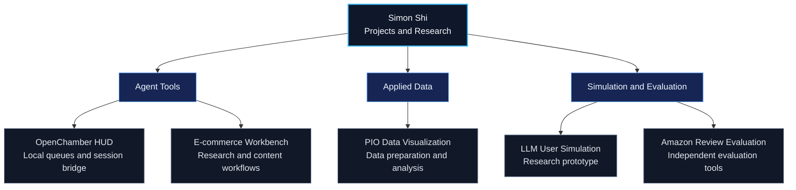

# Simon Shi

### AI Agents · Machine Learning · Forecasting · Simulation

I work on agent tools, data workflows, and simulation problems, with an interest in making model behavior easier to inspect and evaluate.

My academic background spans Mathematics & Computer Science and Statistics at UIUC, and Data Science through UCLA's MEng program.

[Explore my repositories](https://github.com/simonshi-stu?tab=repositories) · [Agent tooling](https://github.com/simonshi-stu/openchamber-application-hud) · [Simulation research](https://github.com/simonshi-stu/llm-user-simulation-agent)

## Current Focus

**01 / Agent tools and workflows**  
Developing interfaces and local workflows for task queues, session interaction, and human review.

**02 / Applied data systems**  
Working with product evidence, pricing scenarios, automotive-parts data, and interactive analysis.

**03 / Simulation and evaluation**  
Exploring LLM-based user simulation, time-aware context, and independent evaluation.

## Project Map

A conceptual overview of my projects and their areas of focus. These are separate projects, not components of one deployed system.

## Selected Projects

### [OpenChamber Application HUD](https://github.com/simonshi-stu/openchamber-application-hud)

A standalone Windows HUD for managing local task queues and interacting with existing OpenChamber sessions.

- Queue controls, pause/resume, and priority adjustments.
- Local message queue and session bridge.
- Real-world application submission remains unverified.

### [E-commerce Content & Operations Workbench](https://github.com/simonshi-stu/E-commerce-Content-and-Operations-Assistant-Agent-for-Individual-Merchants)

A local-first workbench for product research, pricing scenarios, content drafts, and review.

- Organizes product evidence and assumptions alongside the work.
- Supports content drafting and video-reference planning.
- Video workflows currently produce planning handoffs; real video generation is still under development.

### [LLM User Simulation Agent](https://github.com/simonshi-stu/llm-user-simulation-agent)

A research prototype exploring how earlier user history can support simulations of ratings and reviews.

- Time-aware context, reference selection, and output validation.
- Separate [evaluation tools](https://github.com/simonshi-stu/amazon-instruments-evaluation-agent).
- Local language-model training and full evaluation are ongoing; completed full-data training is not claimed.

### [PIO Data Visualization](https://github.com/simonshi-stu/PIO_dataVisualization)

An automotive-parts data workspace for turning Excel workbooks into structured, explorable datasets.

- Workbook intake, field classification, and data-quality summaries.
- Interactive tables, filters, charts, and pivot analysis.
- Forecasting and anomaly detection are planned extensions.

## Background

- **UIUC:** Mathematics & Computer Science + Statistics
- **UCLA:** MEng, Data Science
- **Experience:** Hyundai Mobis, ATLAS, and network-risk research with Wei Wei

## Tools

Python · SQL · R · PyTorch · Pandas · JavaScript · Node.js

## Exploring Next

Forecasting, simulation, backend systems, and decision-support applications, including Disney park planning.
